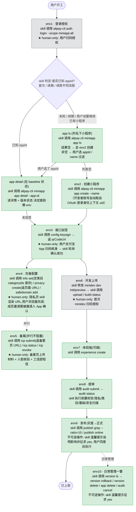

# Mini App Publish Skill

本 skill 由 AI 编程助手 / 终端 agent 内置，主动调用 `alipay-cli miniapp` CLI 命令推进支付宝小程序从创建到上架的完整生命周期。skill 是流程的主体驱动者，自动推进主链，只在 human-only 节点暂停。

## 何时使用

- 用户要在 AI 助手内完成支付宝小程序全生命周期发布
- skill 把 "创建 → 加签 → 配置 → 上传构建 → 提审 → 灰度 → 正式上架 → 日常管理" 串成一条主链，由 skill 主动调用 CLI 工具推进
- 适用场景：终端可执行 `alipay-cli` / `alipay-cli miniapp` 命令、有 OAuth 授权 `miniapp:all` scope 的智能体
- 不适用：纯站点卡片发布；ISV token 认证路径待研（C代B OAuth 鉴权已全链路支持:身份层 McpIdentityFilter 自动拆解 B/C,创建走 isvAppId→ISV_MODE,日常管理身份 uid=B/operatorUid=C 自动透传）

## 路由

- 采用智能意图路由；无法判断用户意图时 skill 先询问用户，不自动调 tool
- tool 报错时 skill 先匹配本 skill 已定义的可恢复错误流程；无法安全恢复时再把错误返回给用户，由用户决定下一步
- 默认走自动主流程；只有用户明确要求"一步一步操作""只创建""只提审"等单步意图时，进入显式分步模式
- 显式分步模式下每一步执行前以用户当前明确指令为准；仍必须遵守 tool 入参契约和安全规范
- C代B（操作员 C 代主账号 B 操作、应用归 B）由服务端按 `operatorUid != uid` 判定，skill 不感知、不对用户暴露

## 全局规范

### 不可逆操作确认规范（调用前先温馨提示并征求 yes）

skill 在调用下列任一命令前，**会**先用温馨提示向用户说明操作目标与影响，并询问「是否确认执行?(请回复 yes 或 no)」；**得到用户明确回复 yes 之后才执行**；用户答非 yes / 超时 / 未回复时，skill 暂不执行并等待用户进一步指示。

| CLI 命令 | 场景 | 温馨提示要点 |
|---|---|---|
| `alipay-cli miniapp publish online --version` | 正式上架 | 全量用户可访问 |
| `alipay-cli miniapp publish gray --version --ratio` | 灰度上架 | 比例只升不降 ≤50% |
| `alipay-cli miniapp publish gray cancel` | 取消灰度 | 灰度版下线 |
| `alipay-cli miniapp version offline` | 下架版本 | 不可恢复 |
| `alipay-cli miniapp version rollback` | 版本回滚 | 线上版本切换 |
| `alipay-cli miniapp app delete` | 删除小程序实例 | 实例删除不可恢复，须先下架 + 取消体验版 |
| `alipay-cli miniapp version delete --version` | 删除开发版本 | 开发中版本构建丢失 |
| `alipay-cli miniapp icp revoke` | 备案撤销 | 备案审核申请撤销，需重新提交 |
| 兜底 `alipay-cli mcp call miniapprelease.publishOnline/publishGray/offlineVersion/rollbackVersion/deleteMiniApp/deleteVersion/icpRevoke` | 同上 | 同上 |

说明：
- 这一步是 skill 自动推进主链中唯一的用户确认点，目的是让用户在不可逆操作前有一次明确知情与放行的机会。
- 用户已在自然语言里说"上架 / 发布 / 灰度 / 下架 / 回滚 / 删除"等意图时，skill 仍以温馨提示再确认一次 yes（不以「用户已表达意图」当作跳过确认的依据）。
- facade 已无 `confirmToken` 两步、单步直执；确认由 skill 温馨提示层完成，详见 `appendix/dangerous-op-confirm.md`。

### 前置命令规范

skill 首先检查并安装 `alipay-cli`：`curl -fsSL https://opengw.alipay.com/alipaycli/install | bash`。`alipay-cli miniapp` 是 `alipay-cli` 的小程序子命令，由 minicenter/developerportal CLI 工具链提供。

### CLI 与 MCP tool 兜底规范

- 每个 CLI 命令都对应 developerportal `MiniAppCliLifecycleMcpFacade` 的一个方法名（1:1, `app ls`→`miniapprelease.queryMiniAppList`,`app detail`→`miniapprelease.queryMiniAppDetail`,`app create`→`miniapprelease.createMiniApp` 等)
- primary 调用: `alipay-cli miniapp <命令> [flags]`
- 兜底调用（CLI 报错 / 缺子命令 / skill 直接调 tool）: `alipay-cli mcp call miniapprelease.<method> --data '<json>'`
- MCP tool 方法名严格对齐 dev McpFacade 方法名（camelCase）: `createMiniApp` `configKeySign` `uploadBuild` `queryBuildStatus` `auditApply` `publishOnline` `publishGray` `manageExperience` `managePrivacy` `queryCategory` `modifyBaseInfo` `queryVersionList` `queryNameModifyCount` `manageSafeDomain` `deleteMiniApp` `offlineVersion` `rollbackVersion` `queryMiniAppList` `queryMiniAppDetail`
- 完整 CLI ↔ MCP tool 映射见 `commands.md`;字段级入参 schema + 各 action/buildMode 示例 JSON 见 `appendix/param-schemas.md`

### 入参不确定时的处理（禁止盲目试错）

- skill **禁止**在不确定某命令/tool 入参时,多次尝试不同参数组合盲猜——应在**第一次**遇到入参不确定或参数校验错误后,**先查入参结构,再调**:
  - `alipay-cli miniapp <command> --help`（CLI 内置 usage,输出入参名/类型/格式）
  - 或读 `commands.md` 该命令编号的"入参"行（含必填/可选/格式说明）
  - 或 `alipay-cli mcp call miniapprelease.<method> --data '{}'`（空 data 触发参数校验错误,反推必填字段名）
- 查到入参格式后,用自然语言告知用户"该命令需要 X(必填)/Y(可选,格式 Z),当前 缺/错的是 W",引导用户补全 → 再调一次
- 遇到 `CLI_PARAM_INVALID` / "格式不正确" / "不能为空" 等参数类错误 → **第一次就查**,不要反复试错

### 可恢复业务错误处理

#### 上传构建达到开发版本上限

`uploadBuild` 返回 `DEV_VERSION_EXCEED_MAX_COUNT` 时，表示该 appId 的开发版本数量已达平台上限。CLI 的版本查询和删除能力已经具备，skill 不重复上传，也不要求服务端绕过配额，按以下流程恢复：

1. 立即停止本次上传重试，保留原上传参数，避免继续产生同类失败。
2. 调用 `alipay-cli miniapp version ls`（MCP 兜底为 `queryVersionList`, `action=LIST_QUERY`）；结果有分页时继续查询，直到拿到全部版本或已找到足够候选。
3. 只筛选状态为 `INIT`（展示文案为“开发中”）的版本。审核中、待上架、灰度中、已上架、已下架版本都不得作为删除候选。
4. 向用户展示候选版本号、创建时间和状态，让用户选择要删除的一个或多个版本。没有开发中版本时停止并返回实际情况，不猜测其它可删除状态。
5. 删除开发版本不可恢复。对用户选中的版本，按“不可逆操作确认规范”说明构建产物会丢失并取得明确 `yes` 后，调用 `alipay-cli miniapp version delete --version <version>`；未确认时不删除。
6. 至少一个版本删除成功后，仅重试一次原 `uploadBuild`。若仍返回上限错误，重新查询版本列表并展示最新状态，不循环删除或无限重试。

#### 查询体验版缺少版本号

`experience get` 对应 `manageExperience(action=QUERY)`：`version` 可选。未传时服务端自动查询该 appId 的最新版本并据此查询体验版；显式传入时严格使用传入版本，不再查最新版本。skill 不需要先执行 `version ls`，也不要因历史错误 `PACKAGE_VERSION_IS_BLANK` 猜测版本后反复重试。若应用没有任何可解析版本，向用户说明需先上传构建或显式指定有效版本。

### OAuth 授权 scope（强制）

miniapp-publish 写类操作需要 `miniapp:all` scope，**默认授权无法执行创建/加签/上传/提审/上架等**。skill 先执行 `alipay-cli diagnose auth --json` 检查登录态与 scope；未登录或 scope 不足时 skill 调用：

```bash
alipay-cli auth login --scope miniapp:all --json
```

登录态确认后 skill 继续推进，不绕过授权检查。

### 授权 scope 不足处理（已登录但 scope ≠ miniapp:all）

当 `alipay-cli diagnose auth --json` 显示已登录但 scope 不含 `miniapp:all`（如仅 `app:write`）时，直接 `auth login --scope miniapp:all` 会沿用旧授权的低 scope token（OAuth 已授权不强制提 scope），仍无法执行写操作。skill 须先退出当前授权再重新登录：

1. skill 据 `diagnose auth --json` 输出判断：已登录且 scope 不含 `miniapp:all`(如 `app:write`) → 判定授权 scope 不足
2. skill 向用户自然语言告知：「当前授权 scope 不足（仅 app:write），需退出当前登录后用 miniapp:all 重新授权。直接重新登录不会提升 scope，会沿用旧授权。」
3. skill 执行 `alipay-cli auth logout` 退出当前授权登录（清旧 token）
4. skill 再执行 `alipay-cli auth login --scope miniapp:all --json`，渲染二维码给用户
5. 用户扫码授权(scope=miniapp:all)后 skill 继续原操作（从断点恢复，不从头重来）
6. 若 logout 后重新 login 仍 scope 不足，skill 终止并告知「alipay-cli 授权异常，scope 未升级到 miniapp:all，请检查 CLI 版本或人工清除登录缓存后重试」

> 与「登录过期处理」区别：登录过期是登录态失效(NOT_LOGIN/AUTH_EXPIRED)，直接重新登录即可；授权 scope 不足是登录态有效但 scope 不够，必须先 logout 退出旧授权再重新登录，否则沿用旧低 scope token。

### 登录过期处理

skill 在任何 CLI/MCP 调用返回"登录态过期"/"未授权"/"token expired"等错误时，**立即停止当前操作并引导用户重新登录**：

1. skill 检测到返回码含 `NOT_LOGIN` / `AUTH_EXPIRED` / `SESSION_EXPIRED` / `401` 等 → 判定登录过期
2. skill 向用户自然语言告知："登录态已过期，需要重新扫码授权"
3. skill 重新执行 `alipay-cli auth login --scope miniapp:all --json`，渲染二维码给用户
4. 用户扫码授权成功后 skill 继续之前被中断的操作（从断点恢复，不从头重来）
5. 若连续 3 次重新登录仍失败，skill 终止并告知用户"请检查 alipay-cli 安装版本或网络后重试"

### 公钥私钥敏感性规范（强制执行）

<important>
**公钥私钥属于敏感信息，必须严格遵守以下规范：**

1. **禁止生成或建议生成密钥**：严禁向用户表示可 "帮助生成公钥/密钥对"，严禁提供 `openssl` / `ssh-keygen` 等密钥生成代码、命令、脚本
2. **禁止接收私钥**：严禁请求、接收、存储或处理用户的私钥信息
3. **仅接受公钥输入**：第一步入参 `publicKey` 由用户明确输入；skill 不生成、不推断、不改写
4. **引导官方工具**：skill 必须先引导用户前往 https://opendocs.alipay.com/common/02kipk 使用官方密钥生成工具
5. **标准话术**："请前往支付宝开放平台密钥生成工具（https://opendocs.alipay.com/common/02kipk）下载并使用官方工具生成应用公私钥对，生成后将应用公钥提供给我继续后续流程。**私钥请妥善保管，切勿泄露给任何人。**"
</important>

## 主链流程图



## 命令一览表

二期补齐后 45 个 CLI 命令按主链流程编排如下（其中 #3/#6/#12 已移除占位，实际可用 42 个）。skill 主动调用每个命令并将其作为 tool spec；CLI 报错可兜底 `alipay-cli mcp call miniapprelease.<method>`；完整 CLI↔MCP tool 映射见 `commands.md`。下表第 4 列为 MCP tool 方法名（与 developerportal `MiniAppCliLifecycleMcpFacade` 方法 1:1 对齐）。

| # | CLI 命令 | 业务动作 | MCP tool (`miniapprelease.<method>`) | 备注 |
|---|---|---|---|---|
| 1 | `app create --name` | 创建小程序实例 | `miniapprelease.createMiniApp` | 所有基础信息均可在本步一次传入(名称/英文名/slogan/logo/类目/客服电话/客服邮箱/desc);CLI createMiniApp 后 app **appStatus=ON_LINE + lifecycle INIT**(与 O站 创建一致),后续 modifyBaseInfo / experience / safedomain / O站 web 全部直接可用;开发者账号取自 OAuth uid |
| 2 | `config keysign` | 接口加签-生成核身页 | `miniapprelease.configKeySign` (action=CREATE_CONFIRM_PAGE) | ★ human-only;写密钥由核身页扫码后平台自完成,无独立确认步 |
| 3 | `config keysign` (step2) | (已移除) | — | 写密钥由核身页扫码后平台自完成,configKeySign 仅生成核身页一步 |
| 4 | `info set` | 修改基础信息 | `miniapprelease.modifyBaseInfo` (action=MODIFY) | CLI createMiniApp 出来的 app appStatus=ON_LINE → **modifyBaseInfo 可用**;增量 incrementalUpdate=true 只传要改字段(未传字段服务端补齐,不被覆盖清空);或全量先 app detail 拿全字段再回传;改名受 每自然年 2 次频率限制(非改名不受限) |
| 5 | `info get` | 查询基础信息 | `miniapprelease.queryMiniAppDetail` (includeBasicInfo=true) | 原 modifyBaseInfo QUERY 已移除 |
| 6 | `info name-check` | 名称校验（已移除） | — | 改名走 info set，冲突由 modify 返回 |
| 7 | `privacy create` | 创建隐私政策 | `miniapprelease.managePrivacy` (action=APPLY) | 返 JSON 含 mcpMode 开关;false=返隐私管理页 URL(skill 渲染给用户浏览器操作),true=CLI 直接提交(skill 读 message 推进) |
| 8 | `privacy get` | 查询隐私政策 | `miniapprelease.managePrivacy` (action=QUERY) | 提审前置 |
| 9 | `mcp call miniapprelease.managePrivacy` (action=CANCEL) | 撤销隐私政策 | `miniapprelease.managePrivacy` (action=CANCEL) | 撤销生效隐私版,撤销后提审前置校验会拦(需重新 privacy create);非不可逆操作,skill 轻量提示即可 |
| 10 | `category ls` | 查询类目树 | `miniapprelease.queryCategory` (action=QUERY_TREE) | |
| 11 | `category require` | 查询类目要求 | `miniapprelease.queryCategory` (action=REQUIRE_QUERY) | appId 可选:传查已选资质/不传查可选类目 |
| 12 | `category edit-url` | (已移除) | — | 二期去页面化:类目设置/信息修改统一走 `info set`(modifyBaseInfo 带 categoryIds 直存,XS 格式如 `XS1014_XS2117`);facade queryCategory GET_EDIT_URL 仍保留但 skill 不再引导用户去页面 |
| 13 | `upload --build-mode` | 上传构建 | `miniapprelease.uploadBuild` | **仅支持 source_afts(默认⭐)与 template 两种模式**;source_afts:CLI 直传 zip 到 AFTS(miniappskill)拿 fileKey→packageUrl 传 fileKey;template:模板实例化构建传 templateId。**code 模式已删除**(fileKey 非 http URL 会 SSRF);source(base64)仅小工程兜底。出参 packageId 必记(version 也要带入 build status)。`DEV_VERSION_EXCEED_MAX_COUNT` 时先 version ls 筛 `INIT` → 用户选择并确认删除 → 重试一次上传 |
| 14 | `build status --version --package-id` | 查询构建状态 | `miniapprelease.queryBuildStatus` | packageId 必填,取自 upload 返回 |
| 15 | `experience create --version` | 创建体验版 | `miniapprelease.manageExperience` (action=CREATE) | CLI createMiniApp 出来的 app lifecycle=INIT (非 PREINIT) → **experience create 可用**;基于已构建的开发中版本设体验版扫码预览。主链 env7 |
| 16 | `experience get` | 查询体验版 | `miniapprelease.manageExperience` (action=QUERY) | version 可选；空则服务端取最新版本，显式传入则按传入版本查询 |
| 17 | `experience cancel` | 取消体验版 | `miniapprelease.manageExperience` (action=CANCEL) | |
| 18 | `audit submit --version --desc` | 提交审核 | `miniapprelease.auditApply` (action=SUBMIT) | 前置校验+备案受限 |
| 19 | `audit status --version` | 查询审核状态 | `miniapprelease.auditApply` (action=QUERY) | skill 告知备案限制 |
| 20 | `version ls` | 查询版本列表 | `miniapprelease.queryVersionList` (action=LIST_QUERY) | |
| 21 | `version show` | 查询版本详情 | `miniapprelease.queryVersionList` (action=DETAIL_QUERY) | version 必填(按版本号精确查);无 version 先 version ls |
| 22 | `name modify-count` | 查询改名剩余次数 | `miniapprelease.queryNameModifyCount` | 唯一扁平入参 appId;MCP 兜底 `{"appId":"..."}` 不带 request 信封(对象入参方法才用 `{"request":{字段}}`) |
| 23 | `publish online --version` | 正式上架 | `miniapprelease.publishOnline` | 不可逆操作: skill 温馨提示说明影响并征求 yes 后单次执行(无 token 两步);未备案走受限发布 |
| 24 | `publish gray --version --ratio` | 灰度上架 | `miniapprelease.publishGray` (cancel=false) | 不可逆操作: skill 温馨提示征求 yes; 比例≤50 |
| 25 | `publish gray cancel` | 取消灰度 | `miniapprelease.publishGray` (cancel=true) | 不可逆操作: skill 温馨提示征求 yes |
| 26 | `safedomain add --domain` | 添加域名白名单 | `miniapprelease.manageSafeDomain` (action=ADD) | CLI createMiniApp 出来的 app appStatus=ON_LINE → **safedomain 可用** |
| 27 | `safedomain delete --domain` | 删除域名白名单 | `miniapprelease.manageSafeDomain` (action=DELETE) | 同 #26,**safedomain 可用** |
| 28 | `safedomain ls` | 查询域名白名单 | `miniapprelease.manageSafeDomain` (action=QUERY) | |
| 29 | `version offline` | 下架版本 | `miniapprelease.offlineVersion` | 不可恢复: skill 温馨提示征求 yes |
| 30 | `version rollback` | 版本回滚 | `miniapprelease.rollbackVersion` | 不可逆: skill 温馨提示征求 yes |
| 31 | `app delete` | 删除小程序实例 | `miniapprelease.deleteMiniApp` | 删除小程序实例(不可恢复);不可逆操作,skill 温馨提示征求 yes;前置:已上架→先下架、存在体验版→先取消体验版 |
| 32 | `app ls` | 查询名下小程序列表 | `miniapprelease.queryMiniAppList` | 续期/续跑入口 |
| 33 | `app detail --app-id` | 查询小程序详情 | `miniapprelease.queryMiniAppDetail` | skill 判 baseline 跳 env;**查密钥状态时必须加 `--include-security-keys true`**(否则密钥段为空,无法判断是否设成功);新增 serviceConfig 段(gatewayUrl/encryptType/openidEnabled/msgSubscriptionList),查开发设置加 `--include-service-config true` |
| 34 | `mcp call miniapprelease.icpSubmit` | 备案提交 | `miniapprelease.icpSubmit` | 返 JSON 含 mcpMode 开关;false=返备案页 URL(skill 渲染给用户浏览器操作),true=CLI 直接提交(skill 读 message 推进) |
| 35 | `mcp call miniapprelease.icpStatus` | 备案状态查询 | `miniapprelease.icpStatus` | 查询备案状态,返 JSON;主要看 `registrationStatus`(INITIAL/AUDITING/SUCCESS/FAIL),`registrationSubStatus` 仅供辅助参考 |
| 36 | `mcp call miniapprelease.icpRevoke` | 备案撤销 | `miniapprelease.icpRevoke` | 撤销备案申请;不可逆操作,skill 温馨提示征求 yes |
| 37 | `mcp call miniapprelease.auditApply` (action=CANCEL) | 撤审(撤回审核) | `miniapprelease.auditApply` (action=CANCEL) | 撤回审核中版本;可重新提审,非不可逆操作,skill 轻量提示 |
| 38 | `mcp call miniapprelease.auditApply` (action=WITHDRAW) | 退回开发 | `miniapprelease.auditApply` (action=WITHDRAW) | 审核中版本退回开发,可重新上传构建提审;非不可逆操作,skill 轻量提示 |
| 39 | `mcp call miniapprelease.deleteVersion` | 删除开发版本 | `miniapprelease.deleteVersion` | 删除开发中版本(不可恢复);不可逆操作,skill 温馨提示征求 yes;skill 调前先查版本状态确认"开发中",非开发中状态返 `CAN_NOT_DELETE_WITHOUT_DEV_STATUS` |
| 40 | `mcp call miniapprelease.queryPluginList` | 查询插件订购列表 | `miniapprelease.queryPluginList` | 查询已订购插件列表 |
| 41 | `mcp call miniapprelease.queryCallableProducts` | 查询可调用产品列表 | `miniapprelease.queryCallableProducts` | 查询可调用产品列表,可按类目分页 |
| 42 | `mcp call miniapprelease.memberInvite` | 邀请成员(开发/体验/应用管理员) | `miniapprelease.memberInvite` | 需应用 owner/MANAGER/APP_MANAGER/DEVELOPER 权限;★human-only 待被邀请人支付宝 App 确认;邀请 MANAGER 角色需应用归属账号操作;memberType=DEVELOPER/EXPERIENCER/MANAGER/DATA_VIEWER/CUSTOM_GRAY_MEMBER |
| 43 | `mcp call miniapprelease.memberRemove` | 移除成员 | `miniapprelease.memberRemove` | 需应用 owner/MANAGER/APP_MANAGER/DEVELOPER 权限;userId 取自 member list 结果 |
| 44 | `mcp call miniapprelease.memberList` | 查询成员列表 | `miniapprelease.memberList` | 返 List<AppMemberInfo> JSON(userId/logonId/nickName/portrait/status/gmtJoin/gmtInvite/role) |
| 45 | `mcp call miniapprelease.pluginSubscribe` | 插件订购/启用 | `miniapprelease.pluginSubscribe` | 订购/启用插件(幂等);pluginId/pluginVersion 必填;gmtActive/Invalid 传 yyyy-MM-dd HH:mm:ss |


> 备注：备案（env5 `icp submit` / `icp status` / `icp revoke`，见 #34-36）、成员管理（env4 `member invite`/`member remove`/`member list`，见 #42-44，需应用 owner/MANAGER/APP_MANAGER/DEVELOPER 权限；★human-only 邀请待被邀请人支付宝 App 确认）；客户端 dev 命令（env6 `dev init` / `dev preview`）仍由 minidev 客户端工具实现，skill 转发并监听结果推进。

## 用户请求与工具参数提取示例

用户原始 Query：“请把小程序 `2021000000000001` 的 `1.2.3` 版本灰度发布到 20%。”

skill 按字段提取：

| Query 片段 | 工具字段 | 提取值 |
|---|---|---|
| `2021000000000001` | `appId` | `2021000000000001` |
| `1.2.3` | `version` | `1.2.3` |
| `20%` | `ratio` | `20` |
| “灰度发布” | `cancel` | `false` |

最终工具调用：

```bash
alipay-cli mcp call miniapprelease.publishGray --data '{"request":{"appId":"2021000000000001","version":"1.2.3","ratio":20,"cancel":false}}'
```

调用前仍须按“不可逆操作确认规范”向用户说明灰度范围并取得明确 `yes`；用户原始 Query 不替代该确认步骤。

## 关键业务约束

### 身份与授权

- skill 在请求里携带 OAuth 凭证（经 CLI 透传），授权 scope 为 `miniapp:all`
- 支持开发者自己操作与代操作（C 代 B）两种模式；C 代 B 由服务端判定，skill 不感知
- 权限校验失败时 skill 收到错误并返回给用户，由用户决定下一步

### 接口加签（一步生成核身页 + 扫码核身）

- skill 不生成公钥；必须先引导用户使用官方密钥工具 https://opendocs.alipay.com/common/02kipk 生成 RSA2 密钥对
- **等用户提供 publicKey 后才调 configKeySign**:用户必须明确输入应用公钥(publicKey);未提供时 skill 停止并等待用户输入,严禁空 publicKey 调 configKeySign(否则 CLI_KEY_SIGN_FAIL: publicKey 不能为空)
- 一步交互:skill 上传用户公钥(透传平台 createKeyConfirmPage)→ 渲染 confirmPageUrl/qrCodeUrl 给用户 → 用户用支付宝 App 扫码核身 → 核身页内平台移动网关自完成写密钥(不需 skill 二次 CONFIRM)→ 用户告知扫码完成 → skill 自动验证加签通路
- configKeySign 仅生成核身页一步;写密钥由核身页扫码后平台自完成,dev 不再有独立 CONFIRM 步(复用 developercore 核身链,缓存/核身页/写密钥由 developercore 统一,避免跨应用缓存隔离)
- **防重复(configKeySign 仅调一次)**:skill 在调 configKeySign 前→先 `app detail --include-security-keys true` 看 securityKeys 是否已配公钥(**必须加 `--include-security-keys true`**，否则 securityKeys 段为 null/占位 `available=false`，无法判断);**已配(hasKeys=true) → skip env3,直接推进 env4**;skill 本会话已调过 configKeySign 且用户确认扫码成功 → **不再重调**,推进 env4;不确定时问用户"该 App 是否已设置接口加签公钥?"→已设 skip / 未设走 configKeySign
- 标准话术见 `appendix/security-and-identity.md`

### 不可逆操作温馨提示确认

- 不可逆操作场景（二期补齐后）：正式上架 / 灰度上架 / 取消灰度 / 下架版本 / 版本回滚 / 删除小程序 / 删除开发版本 / 备案撤销，共 8 类场景（灰度上架与取消灰度是同一命令变体）
- 删除小程序（`app delete`）真实删除已接入,纳入 yes 确认清单；撤审（`audit cancel`）/ 退回开发（`audit withdraw`）/ 撤销隐私政策（`privacy cancel`）属可逆操作，skill 仅做轻量提示，不入 yes 硬清单
- 流程：skill 以温馨提示向用户说明"操作: <desc>, 影响版本/范围, 是否继续?" → 用户答 yes → skill **单次调用直接执行**（服务端 CLI/MCP 渠道已跳过 confirmToken 两步往返，确认由 skill 温馨提示层完成；`confirmRequired` 恒 false）
- 用户未明确答 yes 时 skill 暂不调用 CLI，等待用户进一步指示
- 详细话术与示例见 `appendix/dangerous-op-confirm.md`

### 配置走开放平台页面交互

- 隐私协议创建 `privacy create` 与 备案提交 `icp submit`（默认）走开放平台页面交互（返页面 URL，用户浏览器完成）；二期起 类目设置/基础信息修改 不再走页面，统一由 `info set`（modifyBaseInfo 带 categoryIds）直存
- 业务理由：隐私/备案需人脸核验、材料上传等浏览器交互，类目与基础信息已 CLI 可直存（类目 categoryIds 用 XS 格式如 `XS1014_XS2117`，按分号拆，下划线是 level 连接符）
- 提审前置校验由 skill 调 `privacy get` 与 `category ls` / `info get` 查询配置状态
- URL 模板与 skill 提示话术见 `appendix/o-station-routing.md`

### 提审约束

- 默认非自动上架，不涉及加急
- `version` 可选，不传默认当前最新开发中版本；skill 可先用 `version ls` 列版本供选
- 未完成备案时 "暂时无法上架" → 默认受限发布（50 人/天），完成备案后解除；skill 主动告知用户此限制
- 审核状态查询由 skill 主动告知用户备案限制情况

### 状态机业务规则

- 同一时刻只能有一个审核中版本
- 同一时刻只能有一个灰度版本
- 灰度比例只升不降，上限 50%
- 下架不可恢复
- CLI createMiniApp 创建后 app appStatus=ON_LINE + lifecycle INIT(与 O站 正常创建一致)→ modifyBaseInfo / experience create / safedomain / O站 web 后续操作**全部直接可用**,无需先首发上线
- 类目、隐私未配置时提审会被前置校验拦截
- CLI createMiniApp 后 app lifecycle=INIT(非 PREINIT) → **experience create 可用**(基于已构建的开发中版本设体验版供扫码预览);体验版是"已注册 app 在正式更新前给测试者预览下一版的机制",CLI 创建的 app 已 ON_LINE/INIT → 可直接设
- **modifyBaseInfo / info set 成功后 skill 禁止调 `app detail` 核对**(bug 2026091500119077962): modifyBaseInfo 返 success=true 即成功,已创建信息审核单据(审核中),详情不会立即回显新值;调 app detail 会看到旧值误判"修改未生效",导致 skill 多余地重试或向用户报错。**正确做法:取 facade 返回 success=true 即可推进下一步,不做 detail 二次确认。**
- **modifyBaseInfo 返 `CLI_INFO_AUDIT_PENDING` 时 skill 禁止下线**(bug 审核中不可下绕): 已上架小程序改基础信息走信息审核流程,若已有未完结的审核工单,服务端返此码。skill **不得引导用户下架/下线小程序来绕过审核**,应提示用户"该小程序有审核中的信息修改工单,请等待审核完成后再修改基础信息"。

## human-only 节点 ★ 标记说明

主链流程图与命令详情中，★ 号标注 human-only 节点。skill 在这些位置暂停并向用户展示动作目标，用户完成后 skill 恢复推进：
- 密钥 RSA2 私钥/公钥生成：skill 必须先引导用户前往 https://opendocs.alipay.com/common/02kipk 使用官方密钥工具生成公私钥
- 核身扫码：接口加签时 skill 拿 confirmPageUrl/qrCodeUrl 渲染给用户，等待用户支付宝 APP 扫码确认 → skill 轮询确认成功
- 备案：skill 调 icp submit 返 URL 给用户 → 等待用户在浏览器完成（上传材料 + 人脸核验 + 工信部短信验证）
- 成员邀请确认：skill 调 `miniapprelease.memberInvite`，示例：`alipay-cli mcp call miniapprelease.memberInvite --data '{"request":{"appId":"2021000000000001","inviteLogonId":"user@example.com","memberType":"DEVELOPER"}}'`；返回邀请状态后告知用户需等待被邀请人支付宝 App 确认
- minidev 授权：skill 转发 dev init/preview 首次扫码 → 等待用户授权

## 不可逆操作 yes 确认流程

不可逆操作（`publishOnline`/`publishGray`/`publishGrayCancel`/`offline`/`rollback`/`deleteMiniApp`/`deleteVersion`/`icpRevoke`）skill 不直接执行，先以温馨提示询问用户 "<operationDesc> 即将执行, 目标版本/影响 <...>, 回复 yes 继续"（自然语言，非终端 shell prompt）；user 未明确答 yes 时 skill 暂不调用 CLI 等待进一步指示；user 答 yes 后 skill **单次调用直接执行**（服务端 CLI/MCP 渠道已跳过 confirmToken 两步，无 token 回环）。撤审（`auditApply` CANCEL）/ 退回开发（`auditApply` WITHDRAW）/ 撤销隐私政策（`managePrivacy` CANCEL）属可逆操作，skill 仅轻量温馨提示，不入 yes 硬清单。

## 说明

- 详细命令 IO：`commands.md`
- 接口加签二步交互 + 密钥安全红线：`appendix/security-and-identity.md`
- 不可逆操作温馨提示确认 yes 流程：`appendix/dangerous-op-confirm.md`
- 开放平台页面配置 skill 提示话术：`appendix/o-station-routing.md`
