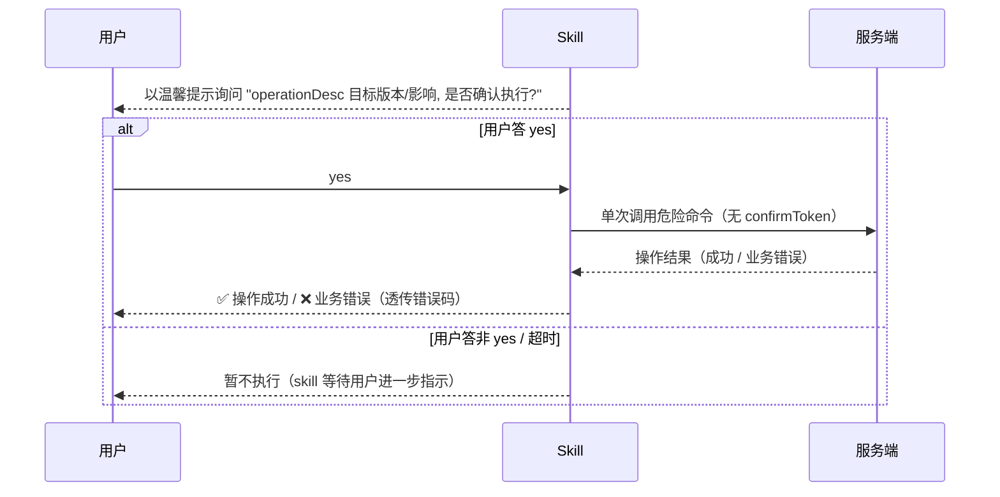

# 危险操作二次确认（温馨提示口径）

本附录定义 4 类危险操作的二次确认 yes 流程、业务前置校验。skill 是危险操作流程的主动驱动者：skill 以温馨提示向用户说明影响并询问 yes/no（非终端 shell prompt），用户答 yes 后 skill **单次调用** CLI/MCP 工具，服务端**直接执行落库**——**无 confirmToken 两步往返**。

> 二次确认由 **skill 自然语言层**完成：skill 问"是否确认执行?"，用户答 yes 后 skill 一次调用即执行；服务端不再生成/校验 confirmToken，返回 `DangerousOpConfirmResult.confirmRequired` 恒为 false（执行完成），失败透传业务错误码。这与"直调 `mcp call` 由人输命令本身即确认"一致——CLI/MCP 渠道不再有服务端 token 回环。

## 适用边界（重要）

二次确认**仅在 skill 驱动流程内生效** —— 即 AI 助手 main loop 中 skill 主动调用 CLI/MCP 工具时，skill 会在执行危险操作前以温馨提示说明影响并询问 yes/no；用户答 yes 后 skill 单次调用，服务端 facade 单步直接执行落库（无 confirmToken 两步往返）。

**不在 skill 驱动内的场景无二次确认**：

- 用户/开发者直接在 shell 手敲 `alipay-cli miniapp <危险命令>` 或 `alipay-cli mcp call miniapprelease.<危险方法> --data '...'`（不经 skill），二次确认**不触发**，危险操作直接执行，**由调用方自负**。
- 若需要让 shell 手敲也有二次提醒，应在 **alipay-cli 工具层**对危险方法加交互确认 prompt（如 `rm -i` 风格），属 alipay-cli 工具的能力，**不在本 skill / 服务端 facade 范围**。

**结论**：facade 无 confirmToken 两步、单步直执（`DangerousOpConfirmer` 已弃用，`confirmToken` 入参字段保留但忽略，`DangerousOpConfirmResult.confirmRequired` 恒 false）；二次确认责任在 skill 语言层，**且仅在 skill 驱动场景生效**。skill 须主动引导用户"危险操作请在 AI 助手内由 skill 推进，勿拷命令手敲绕过 skill"。

---

## 危险操作清单（二期补齐后 8 类场景）

| # | CLI 命令 | 业务场景 | 关键影响 |
|---|---|---|---|
| 1 | `publish online --version` | 正式上架 | 全量用户可访问 |
| 2 | `publish gray --version --ratio` | 灰度上架 | 比例 ≤ 50 只升不降 |
| 3 | `publish gray cancel` | 取消灰度 | 灰度版本回退 |
| 4 | `version offline` | 下架版本 | 不可恢复 |
| 5 | `version rollback` | 版本回滚 | 线上版本切换为上一版本 |
| 6 | `version delete --version` | 删除开发版本 | 开发中版本构建丢失 |
| 7 | `app delete` | 删除小程序实例 | 实例删除不可恢复，须先下架 + 取消体验版 |
| 8 | `icp revoke` | 备案撤销 | 备案审核申请撤销，需重新提交 |
> 注：灰度上架与取消灰度是同一管理动作的两个 CLI 命令变体（`publish gray` vs `publish gray cancel`）；上方 8 类场景对应 8 个 CLI 命令变体。撤审（`audit cancel`）/ 退回开发（`audit withdraw`）/ 撤销隐私政策（`privacy cancel`）属可逆操作，skill 仅轻量温馨提示，不入本清单。

> 删除小程序（`app delete`）真实删除,纳入上方第 7 类 yes 确认清单。

## 二次确认 yes 流程



## 询问模板（统一）

skill 在执行危险命令前，按以下温馨提示模板向用户说明并询问（**问完再调**，未得 yes 不调用）：

```
温馨提示:{operationDesc}
   目标版本:{version}
   操作影响:{impactDesc}
是否确认执行? (请回复 yes 或 no)
```

- 用户答 `yes`：skill 单次调用 CLI 命令，服务端直接执行
- 用户答其他或超时：skill 暂不调用 CLI（等待用户进一步指示）

## 删除小程序专属确认模板（app delete）

删除小程序（`app delete`）风险等级最高，skill 在调用前**必须**完整展示以下专属确认文案，不能省略为统一模板：

```
确认要删除该小程序吗？
小程序删除后不可恢复
您需要关注以下事项：
    1、您无法在开放平台再查看、操作此小程序
    2、小程序名称会立即释放
    3、如果小程序已经完成备案，新建同名小程序后，需要注销原备案记录，并且重新备案。
    4、如果小程序已关联Al开放平台智能体，删除后关联关系将自动解除
我已阅读并明确小程序删除后的风险
是否确认执行? (请回复 yes 或 no)
```

- skill 依次核对 2 条业务前置（`app delete` 须未上架 + 无体验版，见下表），不满足时先引导用户完成下架/取消体验版，不直接删除
- 用户必须回复 `yes` 才执行；回答其他 / 超时 / 仅回复"删吧"等非明确 yes 时，skill 暂不执行并再次确认

## 业务前置校验

服务端在执行时做状态机前置校验，失败直接返业务错误（skill 收到后透传给用户）：

| 命令 | 前置条件 |
|---|---|
| `publish online` | 当前状态须为审核通过或灰度中；未备案走受限发布（50 人/天，CLI 已开 permitRegistrationLimitRelease） |
| `publish gray` | 当前无在灰中的版本；灰度比例 ≤ 50 且只升不降 |
| `publish gray cancel` | 当前在灰度中；未备案放行（取消非上架，已开 permitRegistrationLimitRelease） |
| `version offline` | 当前状态须为已上架或灰度中（下架不可恢复） |
| `version rollback` | 当前须为已上架，且存在可回滚的上一版本 |
| `version delete` | 版本须为开发中状态 |
| `app delete` | 须未上架（已上架 → 请先下架）、无体验版（存在体验版 → 请先取消体验版） |
| `icp revoke` | 须有备案审核申请在途 |

## skill tool output 示例

### 灰度上架（env9）

```
> alipay-cli miniapp publish gray --version 1.0.0 --ratio 10

温馨提示:灰度上架
   目标版本:1.0.0
   灰度比例:10%(只升不降,上限 50%)
   操作影响:10% 用户可访问此版本
[skill 温馨提示说明影响, 用户答 yes 后 skill 单次执行]
⏳ 正在执行灰度上架…
✅ 灰度上架成功
   版本:1.0.0  灰度比例:10%  状态:灰度中
```

### 正式上架（env9）

```
> alipay-cli miniapp publish online --version 1.0.0

温馨提示:正式上架
   目标版本:1.0.0
   操作影响:全量用户可访问
[skill 温馨提示说明影响, 用户答 yes 后 skill 单次执行]
⏳ 正在执行正式上架…
✅ 正式上架成功 🎉
   版本:1.0.0  状态:已上线
```

### 版本回滚（env10）

```
> alipay-cli miniapp version rollback

⏳ 查询可回滚版本…
   当前版本:1.0.0(已上架)→ 可回滚至:0.9.2

温馨提示:回滚
   当前版本:1.0.0 → 目标版本:0.9.2
   操作影响:线上版本将切换为上一版本
[skill 温馨提示说明影响, 用户答 yes 后 skill 单次执行]
⏳ 正在执行回滚…
✅ 回滚成功
   线上版本:0.9.2
```
