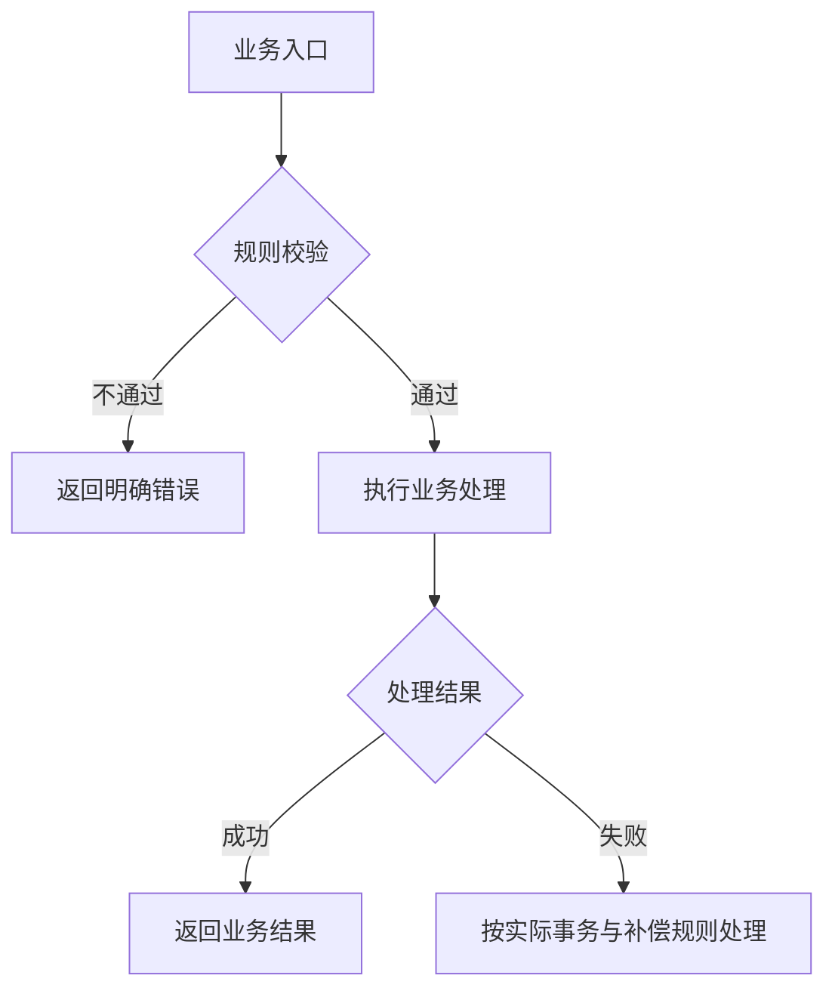
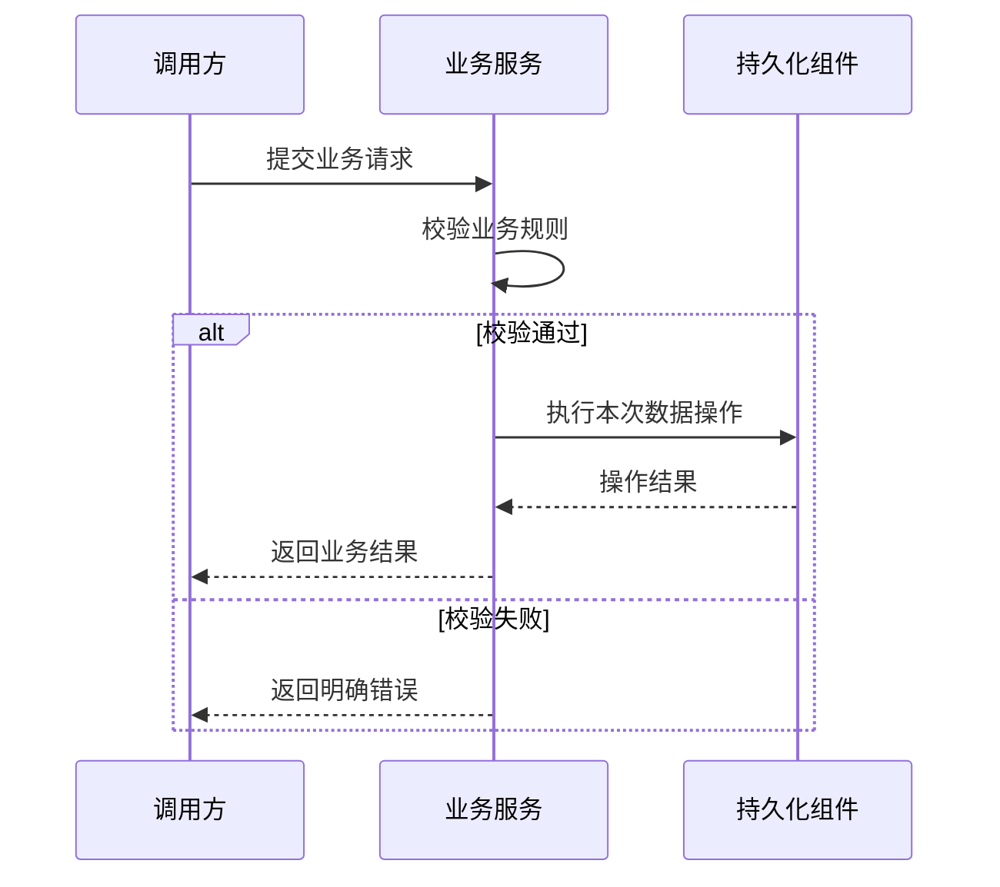

<!--
设计文档模板使用说明

使用通用的工程设计文档结构，保留“规则 → 现状 → 方案 → 流程与数据 → 上线与验收”的组织方式，增加显式的接口与 SQL 清单。

输出位置：`docs/releases/<类型>-<版本>/design/<需求名称>设计.md`。从下方标题开始复制并替换占位符，按任务复杂度展开；接口与 SQL 清单即使无变更也需写明。不要照搬参考文档的业务数据、时间规则或验证结论。
-->

# {{需求名称}}设计

- 目标版本 / 类型：{{版本、feature / bugfix / hotfix / temporary}}
- 关联分支 / 任务：{{分支、任务编号或需求名称}}
- 日期：{{yyyy-MM-dd}}
- 状态：{{设计中 / 已确认 / 已实现待验证 / 已验证；部署情况单独说明}}
- 范围：{{本次涉及的业务、模块、数据和外部系统}}
- 事实来源：{{真实代码位置、需求记录、核查结果及其环境与日期}}

## 1. 目标与已确认规则

描述要解决的问题、当前行为和期望行为，列出业务规则、适用对象、边界与不在本次范围内的内容。

| 规则 | 具体约定 | 边界示例 |
| --- | --- | --- |
| {{规则名称}} | {{已确认口径}} | {{输入、状态或时间条件 → 预期结果}} |

待确认事项单独列出；不要把假设写成已确认需求。

## 2. 现状核查

| 核查项 | 当前事实 | 证据位置 | 对方案的影响 |
| --- | --- | --- | --- |
| {{接口 / 服务 / 表 / 调度 / 消息链路}} | {{实际行为}} | {{文件路径、类/方法或核查结果}} | {{复用、修复或新增原因}} |

列出与需求有关的调用入口、状态、表关系和历史数据问题；引用稳定代码位置，行号仅作辅助。数据快照标明环境与日期，未知项明确说明。

## 3. 总体设计与设计图

说明采用的方案、核心职责分配、复用点及选择理由。存在实质性替代方案时简述取舍；引用相关 ADR，与已有决策冲突时明确指出。

### 3.1 主业务流程图

以下仅为图形语法示例，生成时按真实业务替换节点、分支和结束条件：

### 3.2 关键设计图

围绕真实复杂点选图：模块边界用组件图，交互与事务顺序用时序图，表关系用 ER 图，状态迁移用状态图。跨模块、异步或外部调用需交代失败、重试、超时与事务提交的实际边界。下面为时序语法示例，不代表要求所有业务采用同一架构：

简单方案可合并图示表达，说明其已覆盖流程及设计关系；不为凑图添加不存在的服务或中间件。图源可内嵌或放在 `assets/需求名称流程图.mmd`；导出的 PNG/SVG 与图源放在一起，并在正文中关联。交付前预览或渲染检查标签、连线和分支，不以代码块存在代替图示验证。

## 4. 核心流程、算法与边界

按关键步骤说明读写对象、计算口径和结果变化。按实际需要覆盖：

- 参数校验、权限和数据范围；哪些入口会触发本逻辑。
- 金额、数量、时间的单位、精度、时区及边界，配具体推演示例。
- 多次提交、并发处理、状态流转、事务边界、异步与外部调用。
- 失败、部分成功、结果未知、补偿和停止条件；无需的机制不额外引入。

## 5. 数据设计

说明一条记录代表什么、生命周期、表关系、字段变化以及业务唯一性。

| 表 / 字段 | 类型与约束 | 默认值 / 可空 | 业务含义与本次变化 |
| --- | --- | --- | --- |
| {{表.字段}} | {{实际定义}} | {{规则}} | {{含义、枚举、单位}} |

| 索引 / 约束 | 字段及顺序 | 对应查询或唯一性需求 | 存量影响 |
| --- | --- | --- | --- |
| {{名称}} | {{字段}} | {{依据}} | {{重复值、空值、回填等}} |

无数据结构变化时说明复用的数据及读写影响。正式 DDL 在 SQL 文件中维护，本节引用并解释设计；示意查询明确标记，避免把它当作迁移脚本执行。

## 6. 相关接口与入口清单

| 类型 | 方法 / 触发方式 | 路径 / 类与方法 | 新增 / 修改 / 复用 | 用途与调用方 | 契约或代码位置 |
| --- | --- | --- | --- | --- | --- |
| {{HTTP / 内部方法 / 定时任务 / 消息消费}} | {{HTTP 方法、调用方式或触发条件}} | {{真实入口}} | {{类型}} | {{说明}} | {{真实相对链接或代码位置}} |

HTTP 详细契约链接到 `../api/需求名称接口文档.md`；内部方法、任务和消费者不伪装成 HTTP 接口。没有 HTTP 契约变化时明确说明，并列出本次相关内部入口。

## 7. SQL 清单与执行依赖

| 顺序 | 脚本 | 用途与影响对象 | 执行前提 / 依赖 | 重复执行语义 | 验证与回退 |
| --- | --- | --- | --- | --- | --- |
| {{三位序号}} | {{../sql/序号_需求名称.sql 的实际链接}} | {{DDL / 数据修正 / 字典或配置}} | {{条件及跨目录依赖}} | {{具体说明}} | {{核查方式、回退链接或恢复方案}} |

无数据库变更时明确写“无新增或变更 SQL”。只链接已存在的交付脚本，待编写的脚本标明状态；生成脚本、测试库执行、生产执行分别记录，不混为已完成。

## 8. 实现影响范围

| 模块 / 文件 | 修改内容 | 调用方及兼容性影响 |
| --- | --- | --- |
| {{真实位置}} | {{具体变化}} | {{已有行为如何保留或调整}} |

说明复用与新增组件、依赖变更和接口兼容策略；不要把“计划修改”写成“已实现”。

## 9. 存量、上线与回退

1. {{上线前提、配置、权限、数据检查和必要备份}}
2. {{SQL、应用、前端的执行或部署顺序及多实例兼容要求}}
3. {{存量回填、开关、字典/权限缓存刷新与初始化步骤}}
4. {{上线后只读核查、观测指标和异常判定}}
5. {{回退条件、应用与数据的恢复方案；说明不可逆部分}}

按实际需要删减。配置标识、默认值和生效方式需核实；外部操作仍以用户授权为前提。临时方案补充有效范围及转正式或撤除的安排。

## 10. 验收与验证

| 场景 | 输入 / 前置条件 | 预期 | 验证方式 / 测试位置 | 实际结果 |
| --- | --- | --- | --- | --- |
| {{正常 / 边界 / 权限 / 并发 / 历史兼容}} | {{具体条件}} | {{可核验结果}} | {{测试或检查方法}} | {{未执行 / 通过 / 失败 / 跳过及原因}} |

列出实际执行的命令和必要结果摘要，说明环境与验证范围；算法推演、Mock 测试、真实数据库/外部接口测试和部署结果分别陈述。未执行的项目保持“未执行”，不复制参考文档的通过数或验收结论。

## 11. 已知限制与待确认事项

列出已接受的限制、未验证的假设和仍需决策的问题；若无则明确写“无”。保留与理解最终方案有关的信息，不堆叠过程聊天和重复日志。
