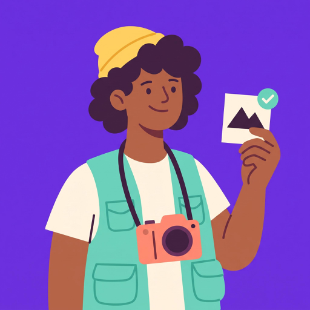

# 摄影选片·MeituHub

从整组照片里挑出好表情和关键瞬间，再按需要生成写真、提升清晰度或修复噪点与暗光。精选和处理结果单独保存，原片不动。

## 可以做什么

| 技能 | 用途 |
| --- | --- |
| 批量选片 | 比较写真、婚礼、活动、旅行、宠物和商品连拍，挑出合适的表情、构图与时刻，输出精选、理由和待复核清单，原片不动。 |
| 写真生成 | 根据人像或宠物参考制作职业形象照、生活写真与艺术照，按要求调整场景、服装和光线，核对主体身份与系列一致性。 |
| 超清 | 提升低分辨率或模糊图片的清晰度，针对人像、商品与文字图检查细节，交付增强图、实际像素尺寸和必要对照。 |
| 画质修复 | 识别噪点、曝光不足、压缩痕迹与模糊问题，选择必要的去噪、暗光增强或修复步骤，交付处理结果与前后对照。 |

## 这样开始

- 从这组照片里选出 30 张，表情自然优先，原片不要动。
- 用这张照片生成一组自然光职业写真，保留本人长相。
- 把这些照片变清晰，噪点和偏暗的分别处理，不改人物。

## 安装与运行

在 Qoder 的插件入口导入本包 ZIP。每包自带 MeituHub 接入，无需 MCP 或另装基础插件；首次使用按提示连接账户，实际调用可能产生用量。

版本 0.4.0。包结构与本地辅助工具已检查，尚未完成 Qoder 安装、自动路由和真实业务调用验收。具体服务以当前账户工具目录为准。PPTX 编辑与预览、XMP 导入、原生小程序运行需相应宿主工具；源码与预览不等于已上线。原文件保留，产物另存。

## 自然语言使用

可以直接描述想要的结果，不必先写技能 ID。技能已补充常用说法和相关场景，自动选择效果以 Qoder 实测为准。查看 [场景识别与分工](references/intent-routing.md)。发布页图标可使用 `assets/plugin-icon.png`。
