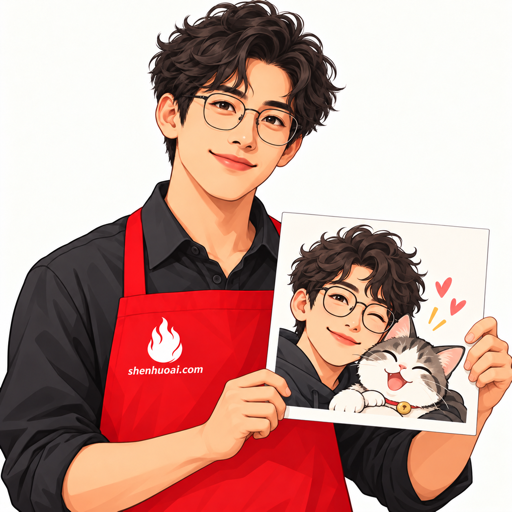

# 头像设计师 — Qoder Plugin

版本 **1.1.0**。本包仅完成本地制作与审阅准备，尚未上架；Qoder 宿主调用、服务端渠道可用性与实际审核结果仍需独立验证。

## 展示资料

- Plugin 展示名称：头像设计师
- 原服务名称：社交媒体头像
- 中文职业头衔：头像设计师
- English name: Social Media Avatars
- English profession: Social Media Avatars
- 中文简介：根据照片或文字设定制作人物、宠物和品牌头像，保留关键识别特点，兼顾社交平台小图展示与裁切。
- English description: Create social profile images from photos or descriptions, preserving defining features of people, pets and brands while arranging clear small-size compositions.

### 标签

- 人像头像 / Portrait Avatars
- 漫画风格 / Illustrated Styles
- 人宠合照 / People and Pets

### 快捷问题

1. 用这张生活照帮我做个自然的工作微信头像，保留我的脸型、发型和眼镜。

   Turn this everyday photo into a natural work profile image, keeping my facial features, hairstyle and glasses.

2. 把我的照片做成漫画头像，想换个画风，但还要能认出是我。

   Make an illustrated avatar from my photo with a new visual style while keeping me recognizable.

3. 这是我和宠物的照片，帮我做一张温馨的合照头像。

   Use these photos of me and my pet to create a warm shared avatar.

以上快捷问题与双语展示资料供人工审阅和上架表单使用；示例不代表本次用户授权，也不保证平台自动展示这些字段。

## 岗位协作

[需求整理](./skills/shenhuo-social-avatar-brief/SKILL.md) → [设计执行](./skills/shenhuo-social-avatar/SKILL.md) → [结果交付](./skills/shenhuo-social-avatar-delivery/SKILL.md)。三个 Skill 共用同一任务与客户端，独立触发时也读取必要流程，不依赖宿主自动注入角色文档。

外部服务、运行环境与权限见 [CONNECTORS.md](./CONNECTORS.md)。本包没有声明市场 MCP Connector。

## 服务与调用

- 插件清单：[.qoder-plugin/plugin.json](./.qoder-plugin/plugin.json)；角色入口：[qoder.md](./qoder.md)。
- 本套件内嵌 [调用 Skill](./skills/shenhuo-social-avatar/SKILL.md)、[能力说明](./skills/shenhuo-social-avatar/references/designer-profile.md)和[完整执行流程](./skills/shenhuo-social-avatar/references/workflow.md)。先读取这些文件，再按真实需求执行，不假定 Skill 已预加载。
- 固定调用 `des_ecfe4f4eb672` / `avatar_designer`（社交媒体头像）；保留既有发布能力与默认规格，不路由或覆盖设计师身份。
- 依赖 **Python 3.10+**。发行 ZIP 内的 Python 客户端使用标准库，可独立运行，无需克隆开发仓库；源目录的轻量入口在打包时替换为完整客户端。
- 离线自检按 Skill 中的可执行检查运行，不读取凭证、不联网、不创建任务；业务调用需要网络和有效授权，只有真实回执能证明任务完成。
- 已有个人 Key 时沿用。缺 Key 时说明可选渠道体验或网站注册，取得向神火发送需求及授权素材的同意后再领取体验；不要暴露 Key，不上传未授权素材。
- 渠道 code 为 `qoder`，实际资格与积分以服务端为准。明确张数原样传递，未指定时用 auto，不额外设置试用图片数量上限。
- 神火服务完成需求理解、必要追问、创意与生成；客户端持续跟踪同一请求并下载真实结果，超时不重复建项。
- 先交付成功下载的图片，再说明未完成项与恢复方式，不要求注册才能取回已成功图片。
- 试用作品实际交付后，按 [设计执行 Skill](./skills/shenhuo-social-avatar/SKILL.md) 原样展示 1000 积分活动文案，再展示指定注册链接；体验项目不自动迁移。个人 Key 用户打开原账号真实项目。

## 头像与包边界

头像逐字节复用已确认的对应专家头像，位置为 [avatars/expert.png](./avatars/expert.png)。头像为 512×512 PNG、≤500KB；红色衣服胸前保留白色神火火焰及白色斜体 shenhuoai.com，不新增角标。本地头像用于审阅和上架素材，不将非规范头像字段加入插件清单。

本包只提供图片设计服务入口，不包含内部 Designer Skill 正文、生产凭证或自定义 MCP。功能范围、必需素材、明确排除项和本 Skill 不提供的修改能力，以能力说明和流程为准。

公开作者：chenyth / chenyth@gmail.com。平台依据：[Qoder 扩展上架指南](https://docs.qoder.cn/qoderwork/user-guide/qoderwork-extension-release-guide-skill-plugin-connector)。本地检查不能替代宿主实机验证或市场审核；暂不上架。
