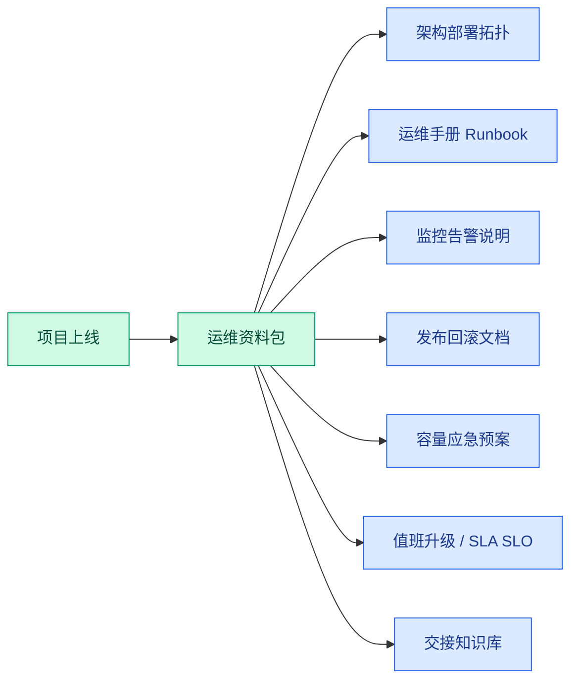
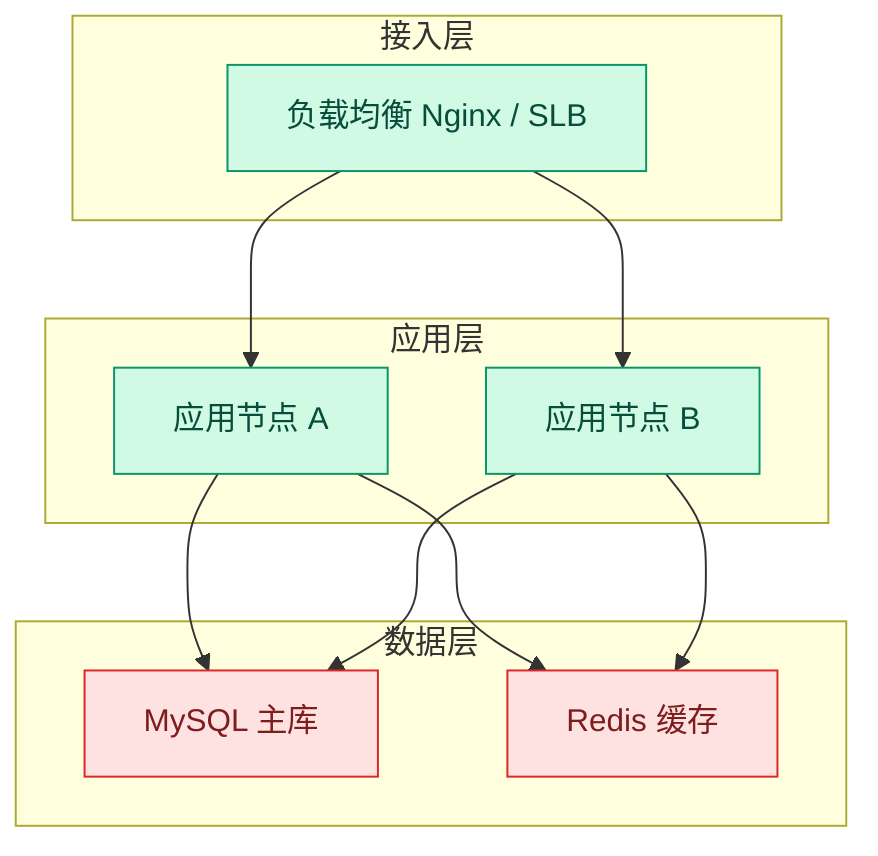
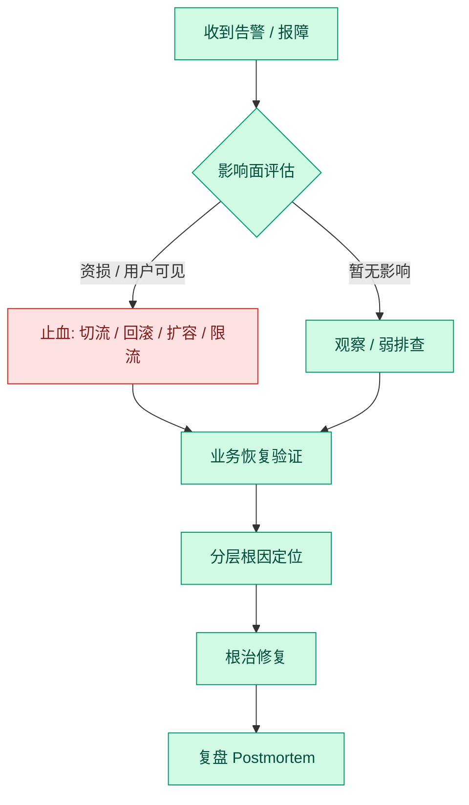
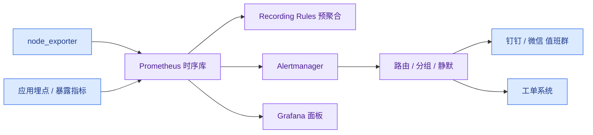
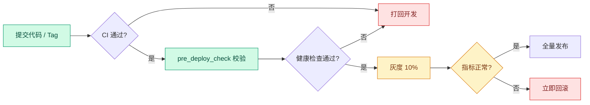
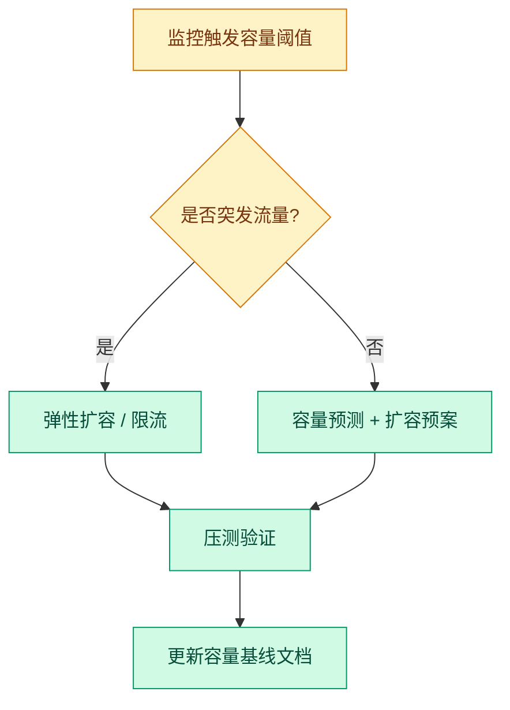
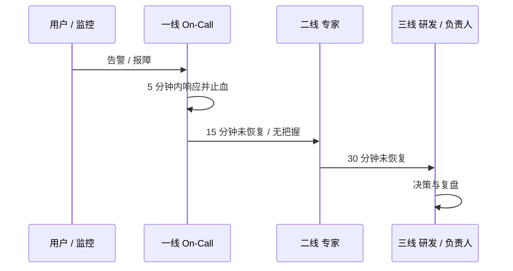
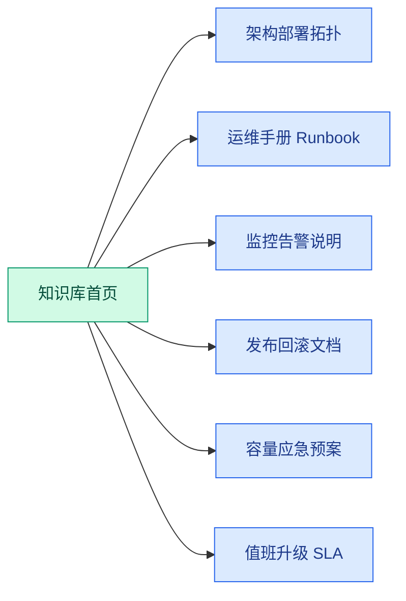

# 项目上线后运维资料输出（运维文档 / 上线文档）

> 本参考在 **项目上线后** 被加载，负责产出一套可交接、可演练、可审计的运维资料。
> 强制红线：**文档内禁止任何 ASCII 字符画 / ASCII 流程图**；所有图示一律用 **mermaid**，
> 语法版本锁定 **≤ mermaid@8.8.3**，且每个图必须带 `classDef` 配色；写完后必须用
> `scripts/validate_mermaid.cjs` 校验，存在 PARSE-ERROR 必须修复后重验。

## 0. 何时触发本能力

- 关键词：运维文档 / 上线文档 / 运维手册 / Runbook / 部署拓扑 / 监控说明 / 交接文档 / 知识库 / 容量预案 / 应急文档。
- 显式调用：`@子能力 references/ops-docs.md`。
- 场景：新项目/新版本上线、老项目补文档、交接前资料沉淀、审计/等保材料准备。

## 1. 交付物清单（一张图讲清）



| 文档 | 一句话定义 | 必备图示 |
|------|------------|----------|
| 架构部署拓扑 | 系统由哪些组件、怎么连、流量怎么走 | 拓扑图 |
| 运维手册 Runbook | 日常操作 + 故障应急的标准动作 | 应急流程图 |
| 监控告警说明 | 看什么指标、为什么告警、去哪看面板 | 监控数据流图 |
| 发布回滚文档 | 怎么发、怎么回、触发条件 | 发布流程图 |
| 容量应急预案 | 扛多少量、不够怎么办 | 扩容决策图 |
| 值班升级 / SLA·SLO | 谁兜底、多久响应、可用性目标 | 升级链路时序图 |
| 交接知识库 | 坑、约定、未决项、联系人 | 知识库清单（表格） |

## 2. 文档规范（强制红线）

1. **禁止 ASCII 图表**：不得用手绘字符画、ASCII 框图、纯文本箭头排版表达结构。结构类内容一律改用 mermaid。
2. **mermaid 版本 ≤ 8.8.3**：只使用 8.8.3 可解析的稳定语法——
   `graph`（含 `TD`/`LR`/`TB`）、`sequenceDiagram`、`classDiagram`、`stateDiagram-v2`、
   `erDiagram`、`gantt`、`journey`。**不要**用 `mindmap` / `timeline` / `C4` / `architecture` 等 8.8.3 之后的新增图表。
3. **每个图必须带 `classDef` 配色**：节点按角色着色（业务 / 基础设施 / 数据 / 监控 / 人），
   颜色与 house 风格一致（见各模板）。
4. **图要有标题与图注**：每个 mermaid 块上方写明"图 N：xxx"，下方一行说明"图 N 说明：……"。
5. **图随文档走**：图示不是装饰，是文档主体；文字只解释"为什么"和"怎么用"，结构留给图。
6. **写后校验**：见第 4 节，存在 `[ERR]`（PARSE-ERROR）不得交付。

## 3. mermaid 语法门禁（版本与配色约定）

- 节点形状：矩形 `id[文本]`、圆角 `id(文本)`、菱形决策 `id{文本}`、圆柱（数据库）`id[(文本)]`。
- 中文与空格可直接写，含特殊字符（括号/冒号/斜杠）建议用双引号包住：`id["文本(含括号)"]`。
- 连线：`-->`（实线箭头）、`---`（无箭头）、`-.->`（虚线）；决策分支标签用 `-- 文本 -->`。
- 配色角色（统一）：
  - 业务/核心：`#d1fae5` 底 `#059669` 边 `#064e3b` 字（绿）
  - 基础设施/文档：`#dbeafe` 底 `#2563eb` 边 `#1e3a8a` 字（蓝）
  - 监控/可观测：`#ede9fe` 底 `#7c3aed` 边 `#4c1d95` 字（紫）
  - 数据：`#fee2e2` 底 `#dc2626` 边 `#7f1d1d` 字（红）
  - 止血/危险：`#fee2e2` 底 `#dc2626` 边 `#7f1d1d` 字（红，加粗语义）
  - 警告/观察：`#fef3c7` 底 `#d97706` 边 `#78350f` 字（黄）

## 4. 校验流程（复用 validate_mermaid.cjs）

脚本已复制至本技能 `scripts/validate_mermaid.cjs`（与 p8-full-stack 同源）。

**前置（一次性，不进交付包）：**

```bash
cd scripts
npm install mermaid@8.8.3 jsdom
```

**运行（逐文件校验所有 mermaid 块）：**

```bash
node scripts/validate_mermaid.cjs references/ops-docs.md
node scripts/validate_mermaid.cjs <你的运维文档>.md
# 多文件
node scripts/validate_mermaid.cjs a.md b.md c.md
```

**结果语义：**

- `[OK]` 解析并渲染成功（权威判定用 `mermaid.parse`）。
- `[ERR]` 真实语法错误（消息含 `Parse error`）——**必须修复**。
- `[WARN]` jsdom 渲染环境限制（如 `getBBox`），pytora/真实渲染不受影响——可忽略。

**退出码：** `0` 无语法错误；`1` 存在语法错误；`2` 文件不可读或未发现 mermaid 块。

> 门禁：**只要出现 `[ERR]`（退出码 1），该文档不得交付**，修复后重跑至全绿。

## 5. 各文档模板（含 mermaid 图示）

---

### 5.1 系统架构与部署拓扑文档

结构：目标与边界 → 组件清单 → 部署拓扑图 → 依赖与上下游 → 网络与端口 → 数据流向 → 容灾。



图 1 说明：左到右为流量方向；绿色为业务/应用节点，红色为数据存储。需补充各节点 IP、端口、实例数、主从关系。

---

### 5.2 运维手册 / Runbook（日常 + 应急）

结构：服务清单 → 启停/重启命令 → 配置位置 → 日志位置 → 应急流程图 → 常见故障速查表。



图 2 说明：故障处理顺序硬约束 **发现 → 止血 → 恢复 → 定位 → 修复 → 复盘**；红色为止血动作，不得被根因分析阻塞。

---

### 5.3 监控告警说明文档

结构：监控目标 → 采集指标清单 → 监控数据流图 → 告警规则表（含阈值/级别/Runbook 链接）→ 面板清单。



图 3 说明：蓝色为数据源/通知渠道，紫色为监控体系内部组件。告警规则须由 `scripts/gen_alert_rules.py` 生成并附 Runbook 链接。

---

### 5.4 部署发布与回滚文档

结构：发布策略选型 → 发布流程图 → 上线检查清单 → 回滚预案（触发条件 + 步骤 + 时长）→ 灰度方案。



图 4 说明：绿色为正常路径，黄色为灰度观察，红色为打回/回滚。回滚触发条件须量化（错误率、延迟、资损）。

---

### 5.5 容量评估与应急预案

结构：容量基线（QPS/连接数/存储）→ 瓶颈点 → 扩容决策图 → 预案步骤 → 压测验证结论。



图 5 说明：黄色为阈值/判断，绿色为处置与沉淀。容量基线须有压测数据支撑，禁止拍脑袋。

---

### 5.6 值班与升级 / SLA·SLO 文档

结构：On-Call 排班 → 升级链路时序图 → SLA/SLO/SLI 定义与计算 → 错误预算 → 疲劳保护。



图 6 说明：升级时限须写进合同/SLA；一线必须 5 分钟内响应并尝试止血，不得无限期占线。

---

### 5.7 交接与知识库文档

结构：系统负责人与备份人 → 关键联系人 → 已知坑与规避 → 未决项清单 → 文档索引（指向上述 6 类文档）。

> 此类以表格为主，无需 mermaid；但若要表达"文档间引用关系"，可用以下图：



图 7 说明：知识库是总入口，向下聚合 6 类文档；交接时只需交"知识库首页 + 各文档路径"。

## 6. 产出闭环（交付前自检）

- [ ] 7 类文档齐全（或按项目裁剪后明确标注"不适用"）
- [ ] 每个结构类内容均有 mermaid 图，无 ASCII 字符画
- [ ] 每个 mermaid 图含 `classDef` 配色，角色着色一致
- [ ] 已运行 `node scripts/validate_mermaid.cjs <文档>` 且退出码 0（无 `[ERR]`）
- [ ] 所有命令/路径/端口/阈值均已填实，无 `xxx` 占位
- [ ] Runbook 与回滚预案经过一次演练或评审
- [ ] 文档路径已登记进知识库首页（图 7）

> 收尾：复杂档/上线类任务强制在交付后做一次 **复盘**，把新坑沉淀进对应 reference 或知识库。
