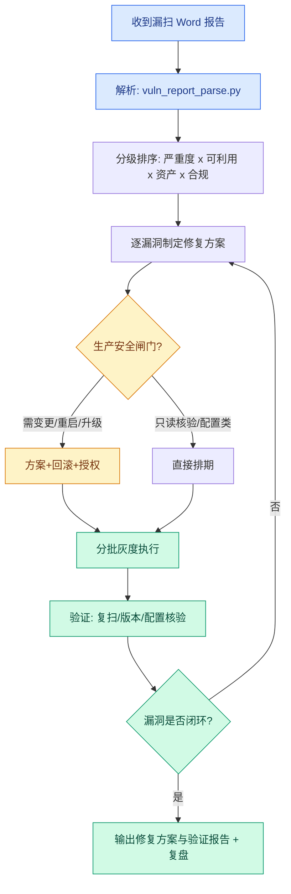
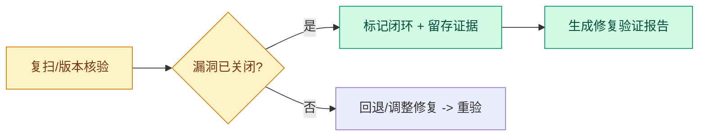

# 漏洞修复流程（从 SKILL.md §四 展开）

> 本参考在 **收到漏洞扫描报告 / 安全评估报告 / 等保基线检查** 时加载，负责把一份
> （通常是 Word 的）漏扫分析报告转化为**可执行的漏洞修复方案**，并沿用 ops-expert 的
> 生产安全闸门与证据化闭环：修复先方案 + 回滚 + 授权，验证靠复扫/核验而非"应该修了"。

## 0. 何时触发本能力

- 关键词：漏洞扫描 / 漏扫报告 / 安全评估报告 / 漏洞分析报告 / 漏洞修复 / CVE / CVSS /
  高危漏洞 / 中危漏洞 / 等保 / 基线检查 / 安全加固 / 应急漏洞（如 Log4j、OpenSSL）。
- 显式调用：`@子能力 references/vuln-remediation.md`。
- 典型场景：收到第三方漏扫 Word 报告、等保/基线检查整改、突发高危漏洞应急修复。

## 1. 总体流程（vuln 闭环）



图 1 说明：解析 → 排序 → 方案 → 闸门 → 灰度执行 → 验证闭环。任何涉及升级/重启/配置变更的动作，
必须走生产安全闸门（方案 + 回滚路径 + 显式授权），缺一项不执行。

## 2. Step 1 解析报告（脚本优先）

优先调用 `scripts/vuln_report_parse.py`，把 Word(.docx) 报告转为结构化清单，避免人工
逐行翻找、也避免模型臆测：

```bash
# 仅解析并打印摘要
python3 scripts/vuln_report_parse.py --in 漏扫报告.docx
# 同时导出结构化清单与报告全文（全文供人工/模型研判）
python3 scripts/vuln_report_parse.py --in 漏扫报告.docx --out findings.md --raw raw.txt
```

脚本输出（stdout + 可选 findings.md）：

- **概览统计**：候选漏洞条目数、识别到的 CVE 编号数、严重度关键词分布。
- **资产清单**：从报告抽取的主机/IP/域名。
- **CVE 清单**：去重后的 CVE 编号。
- **漏洞条目（按严重度排序，待研判）**：`# | 严重度 | CVE | 关键词 | 原文片段` 表。

> 重要：脚本是基于**关键词 + 正则**的初步抽取，可能漏报（报告格式特殊）或误报（关键词歧义）。
> 必须结合 `--raw` 全文与原始报告人工核对，再进入修复方案制定。脚本不替代研判。

报告非 `.docx`、或解析为空：提示用户转成 `.docx` 或纯文本后重试，或直接将报告正文粘贴进对话。

## 3. Step 2 分级排序（四维权重）

不要只按报告标注的"高中低危"机械排序。按四维度综合定优先级：

| 维度 | 含义 | 高优先级信号 |
|------|------|--------------|
| **严重度** | CVSS 评分 / 报告标注（严重>高危>中危>低危） | CVSS ≥ 9.0 / 严重 / 高危 |
| **可利用性** | 是否有公开 EXP / PoC、是否无需认证即可利用 | 已有公开武器化利用、远程无需认证 |
| **资产重要性** | 是否互联网暴露、是否核心业务、是否含敏感数据 | 公网可达、核心链路、数据库/域控 |
| **合规约束** | 等保/PCI/行业监管红线 | 等保高风险项、监管限期整改 |

**优先级矩阵（建议）：**

| 组合 | 处置级别 | 建议时限 |
|------|----------|----------|
| 高严重 + 公网可利用 + 核心 | **P0 紧急** | 24h 内（应急窗口） |
| 高严重 + 内网/需认证 | P1 高 | 7 天内 |
| 中危 + 公网可利用 | P1/P2 | 7–30 天 |
| 中危 + 内网 | P2 中 | 30 天内 |
| 低危 / 信息类 | P3 低 | 排期或接受风险 |

> 避坑：互联网暴露的"中危"往往比内网隔离的"高危"更急——**暴露面优先于纸面严重度**。

## 4. Step 3 制定修复方案（逐漏洞）

对每一条漏洞，按统一模板给出方案。**每条必须含：影响面（2 跳上游依赖）、修复动作、
回滚路径、验证方式、业务窗口。** 复用 SKILL.md §三的生产安全闸门。

| 字段 | 必填内容 |
|------|----------|
| 漏洞 | CVE 编号 / 名称 / 严重度 / 影响资产 |
| 根因 | 为什么存在（版本过旧 / 配置不当 / 代码缺陷 / 架构暴露） |
| 修复动作 | 具体命令或配置变更（升级版本 / 打补丁 / 改配置 / 代码修复 / WAF 缓解） |
| 影响面 | 该资产影响的上游业务与下游依赖（至少 2 跳） |
| 回滚路径 | 如何快速还原（快照/备份/旧版本/配置回退），并事先验证可行 |
| 验证方式 | 复扫确认关闭 / 版本核验（`rpm -q`/`dpkg -l`）/ 配置核查 / 业务冒烟 |
| 业务窗口 | 可变更的维护窗口、是否需要灰度/摘流量 |

### 4.1 分类修复知识库

| 漏洞类别 | 典型表现 | 修复动作 | 回滚 / 注意 |
|----------|----------|----------|-------------|
| **系统/组件版本漏洞** | OpenSSL/glibc/OpenSSH/kernel 存在 CVE | 升级对应包到修复版本（`yum update`/`apt upgrade`/打补丁） | 升级前快照/备份；内核升级需重启，走维护窗口；验证 `version`/`rpm -q` |
| **中间件版本漏洞** | Nginx/Redis/MySQL/Tomcat 版本过低 | 升级到安全版本 / 应用官方补丁 | 先备份配置与数据；Redis 注意未授权访问需同时加认证 |
| **弱口令 / 认证** | 默认口令、弱密码、空口令 | 改强口令、启用多因素、限制来源 IP | 改密后同步应用配置；避免锁定服务账号 |
| **不安全协议/配置** | TLS1.0/1.1、弱加密套件、开放多余端口、目录遍历 | 禁用旧协议、收紧加密套件、关闭冗余端口与服务 | 改前备份配置文件；确认无老旧客户端依赖旧协议 |
| **Web 应用漏洞** | SQL 注入 / XSS / SSRF / 文件上传 / 命令注入 / 反序列化 / XXE | 代码层根治（参数化/过滤/白名单）+ 临时 WAF 规则缓解 | **不盲目改生产**：先 WAF 缓解 + 开发排期根治；记录临时缓解的到期日 |
| **容器 / K8s** | 镜像含已知 CVE、特权容器、未设网络策略 | 更新基础镜像重 build、降权、加 NetworkPolicy | 镜像升级需重新发布，走发布流程（见 `references/deployment.md`） |

## 5. Step 4 评审与授权（生产闸门）

- 复用 SKILL.md §三"生产安全闸门"：凡涉及 **升级 / 重启 / 配置变更 / 网络变更 / 权限调整**，
  必须先给 **方案 + 回滚路径 + 显式授权**，用 AskUserQuestion 或明确确认，禁止默认执行。
- 批量修复**分批灰度**：先单节点/单批次验证，观察监控与业务无异常后再全量；单批失败即停。
- 涉及数据风险（如数据库升级）的操作，**先备份/快照再动**。

## 6. Step 5 执行与验证

- **验证优先于"宣告完成"**：无证据 = 没做完。
- 修复后必须 **复扫**（用同一工具/同策略重扫）确认对应漏洞已关闭，或：
  - 版本核验：`rpm -q <pkg>` / `dpkg -l <pkg>` / `<bin> --version`；
  - 配置核查：grep/diff 确认配置已生效；
  - 业务冒烟：关键接口/端口探活，监控无异常。
- 保留变更前后证据（命令 + 输出 + 退出码 + 复扫结果），用于复盘与审计。

## 7. Step 6 复盘闭环

- 输出《漏洞修复方案与验证报告》（结构见第 8 节，可含 mermaid）。
- **沉淀**：重复出现的漏洞类型（如总在低版本组件）→ 反哺 `references/env-init.md`
  安全加固基线 / 变更流程，减少下次同类问题。
- 临时缓解项（如 WAF 规则）必须登记到期日与根治排期，避免长期"带病运行"。

## 8. 输出物：漏洞修复方案与验证报告（结构）

1. **背景与目标**：报告来源、扫描时间、范围、合规依据。
2. **漏洞总览**：严重度分布、P0–P3 分级清单（引用脚本 findings.md）。
3. **逐漏洞修复方案**：按第 4 节模板逐条（影响面/修复/回滚/验证/窗口）。
4. **执行计划**：分批灰度顺序、维护窗口、责任人。
5. **验证结果**：复扫/核验证据表（漏洞 → 修复前 → 修复后 → 状态）。
6. **残留风险与排期**：未修复项、临时缓解到期日、后续根治计划。



图 2 说明：验证闭环。未关闭的漏洞回到修复调整，禁止"应该修了"式结案；全部闭环后生成报告。

## 9. 避坑清单

- 不要只看纸面严重度而忽略**暴露面与可利用性**（公网中危可能比内网高危更急）。
- 升级/重启前**必须备份/快照**，回滚路径事先验证，不靠运气。
- Web 漏洞**不盲目改生产代码**，先 WAF 临时缓解 + 开发根治排期，并登记缓解到期日。
- 复扫确认**闭环**，不留"应该修了"的口头结论；临时缓解项必须设到期与根治计划。
- 脚本抽取结果**必须人工核对**原始报告，漏报/误报都可能发生。
